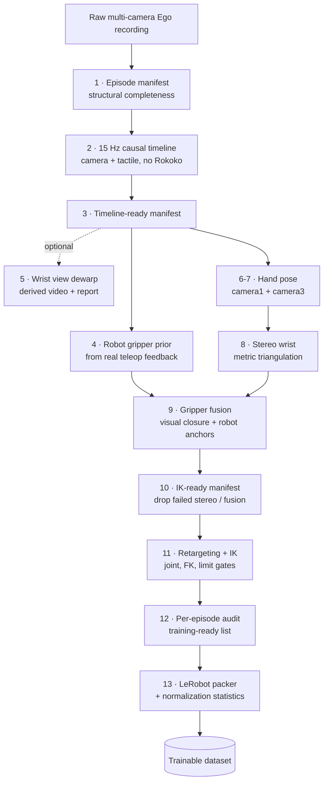

# Embodied Post-Processing Pipeline

Turn raw multi-camera human demonstrations into trainable robot datasets — reproducibly, with an explicit quality gate at every stage.

[](https://github.com/fangdiyu/embodied-postprocess-pipeline/actions/workflows/ci.yml)
[](pyproject.toml)
[](LICENSE)
[](#project-status)

**[中文说明](README.zh-CN.md)**

---

## The problem

Collecting embodied-AI data is the easy half. The hard half is the part nobody
writes down: the three cameras do not share a clock, the hand detector drops
frames exactly where the grasp happens, monocular hand models return
*scale-ambiguous* depth that looks like metres but is not, the robot gripper
speaks a different unit system than the human hand, and IK silently produces a
trajectory that violates joint limits.

The usual outcome is a folder of scripts, a dataset that "mostly works", and no
way to tell which episodes are actually safe to train on.

This repository is the other half: a **configurable, resumable, auditable
post-acquisition pipeline** that turns raw Ego recordings into a LeRobot dataset,
and refuses to let a bad episode through silently.

## Pipeline at a glance



Every arrow is a stage in a JSON config. Every stage is a plain argv array, run
without a shell. Nothing is deleted, renamed, or renumbered in the source data —
selection is always expressed as a manifest.

Stage 5 is the only one that rewrites pixels, and it writes to a new file: the
wrist view is dewarped into `rgb/<camera>_undistorted.mp4` next to the untouched
source. Nothing downstream reads that file unless you point a stage at it, so it
is safe to leave in the template and ignore.

## Design principles

**Dry run by default.** `pipeline.py` prints the resolved variables, the missing
prerequisites, and the exact commands. Nothing executes until you add
`--execute`.

**No shell, ever.** Stages are `argv` arrays, not strings. Paths with spaces are
safe, and the exact `argv` that ran is written to the provenance report.

**Source episodes are immutable.** A manifest records which episodes are in and
which are out, and why. Re-running with a different filter never touches the
recordings.

**Quality is a gate, not a warning.** `PASS`/`FAIL` status files are consumed by
the next stage. An episode that fails stereo triangulation cannot reach the
packer, even if you forget to exclude it.

**Weak signals are labelled as weak.** The robot gripper phase profile is an
occlusion fallback with a low fusion weight; a valid visual observation always
wins. Monocular hand depth is never presented as metric depth.

**Backends are replaceable.** HaMeR, MediaPipe, MANO; Nero, Franka, UR, xArm;
π0.5, ACT, Diffusion Policy. The orchestrator only knows the interface in
[`ADAPTER_CONTRACTS.md`](postprocess_pipeline/ADAPTER_CONTRACTS.md).

## Quick start

```bash
git clone https://github.com/fangdiyu/embodied-postprocess-pipeline.git
cd embodied-postprocess-pipeline
python -m pip install -r requirements.txt
```

The runner itself is **standard library only**. NumPy, pandas, and PyArrow are
needed by the tabular episode tools; the demo below needs nothing else.

List the stages of the portable template:

```bash
python postprocess_pipeline/pipeline.py \
  --config postprocess_pipeline/configs/ego_hamer_stereo_ik.template.json \
  --list
```

Dry run with your own paths (this only prints; it does not touch data):

```bash
python postprocess_pipeline/pipeline.py \
  --config postprocess_pipeline/configs/ego_hamer_stereo_ik.template.json \
  --set source_root=/datasets/my_ego_recordings \
  --set robot_dataset=/datasets/my_robot_demonstrations \
  --set episode_first=1 \
  --set episode_last=120
```

Add `--execute` once the plan looks right. Run a single stage, a range, or
resume a partial run:

```bash
# one stage
python postprocess_pipeline/pipeline.py --config CONFIG.json \
  --stage manifest_raw --execute

# a contiguous range
python postprocess_pipeline/pipeline.py --config CONFIG.json \
  --from-stage hamer_camera1 --to-stage audit --execute

# skip stages whose declared outputs already exist
python postprocess_pipeline/pipeline.py --config CONFIG.json --resume --execute
```

Each real run creates a timestamped directory under `run_root` containing
per-stage stdout/stderr logs, the exact argv, the resolved variables, the config
SHA-256, the interpreter and platform, per-stage durations, and the final status.

## Try it without any data

The demo generates a synthetic two-episode recording and runs the real pipeline
end to end — no cameras, no GPU, no ffmpeg, no external model:

```bash
python examples/make_demo_dataset.py --output demo_data
python postprocess_pipeline/pipeline.py \
  --config examples/demo.pipeline.json --execute
```

It exercises the manifest gate, the 15 Hz causal timeline, the robot gripper
prior, the hand-closure fusion, and the IK-ready filter. The hand-pose and stereo
stages are replaced by a clearly-labelled simulator, so what you are testing is
the **orchestration and the quality gates**, not HaMeR's accuracy. See
[`examples/README.md`](examples/README.md) for what each fixture represents.

## Repository layout

```text
pipeline.py                     generic stage runner (stdlib only)
pipeline.schema.json            public JSON config schema
tools/
  build_episode_manifest.py     non-destructive episode selection
  filter_episode_manifest.py    derived-artifact and status gates
  run_with_manifest.py          pass stable episode IDs to any adapter
  build_robot_gripper_prior.py  robust prior from robot feedback
  audit_episode_artifacts.py    per-episode training-readiness gate
adapters/
  build_ego_no_rokoko_15hz_timeline.py   camera/tactile 15 Hz timeline
  fuse_hamer_revo2_gripper.py            visual closure + robot anchors
  build_ego_fruit_ik_trajectory.py       metric wrist → 7-DoF joint path
  prepare_pi05_ego_fruit_lerobot.py      LeRobot v3 packer + statistics
configs/                        portable template + real-world examples
examples/                       synthetic demo dataset and config
docs/                           architecture, stage reference, troubleshooting
```

## What ships, what you bring

The orchestrator, the manifest/audit tools, and the timeline, fusion, IK, and
packing adapters are complete and runnable. Three things are **deliberately not
vendored**, because they are separate projects with their own licenses and
release cadence:

| Not included | Why | Plug in via |
| --- | --- | --- |
| Hand-pose estimator (HaMeR / MediaPipe / MANO) | Model weights and license terms are upstream | `hamer_camera1`, `hamer_camera3`, `stereo_wrist` stages |
| Robot URDF + IK solver | Robot-specific, often under NDA | `--ik-backend-script` |
| LeRobot packing helpers | Part of the HumanEgo toolkit (**PolyForm Noncommercial 1.0.0**) | `HUMANEGO_PIPELINE_ROOT`, or write your own packer |

The packer adapter imports the HumanEgo toolkit lazily: `--help` and
`--finalize-only` work without it, and a missing toolkit produces one actionable
error message instead of an `ImportError` traceback. See
[`THIRD_PARTY.md`](postprocess_pipeline/THIRD_PARTY.md) before publishing weights
or a dataset built with it.

The reference hand-pose and stereo implementations used during development live
in the companion repository
[`ego-dropper-toolkit`](https://github.com/fangdiyu/ego-dropper-toolkit). Any
backend that satisfies the contract works — the pipeline does not import it.

## Configuration

A minimal config is a `variables` map and a `stages` list:

```json
{
  "schema_version": 1,
  "name": "my-pipeline",
  "variables": {
    "project_root": "{config_dir}/../..",
    "source_root": "{project_root}/data/raw",
    "artifact_root": "{project_root}/artifacts/my-run"
  },
  "run_root": "{artifact_root}/runs",
  "stages": [
    {
      "name": "validate",
      "cwd": "{project_root}",
      "requires": ["{source_root}"],
      "produces": ["{artifact_root}/manifest.json"],
      "command": ["python", "validate.py", "{source_root}",
                  "--output", "{artifact_root}/manifest.json"]
    }
  ]
}
```

Variables may reference other variables; `config_dir` is supplied automatically;
`--set NAME=VALUE` overrides any of them without editing JSON. Only
identifier-shaped `{placeholders}` are expanded, so JSON snippets and paths
containing other braces pass through unchanged — while a mistyped variable name
is still an error rather than a silently broken path.

Use `accept_returncodes` when a tool intentionally signals "completed, some
episodes rejected" with a non-zero status:

```json
"accept_returncodes": [0, 3]
```

Rejected episodes still have to be excluded by the audit before packing.

## Data invariants

These are enforced by the tools, not just documented:

- Raw episode identifiers are immutable; selection lives in manifests.
- Time alignment states whether it is causal and which modalities bound the
  common valid interval.
- Three cameras are three views of one trajectory, not three times the duration.
- Weak-perspective hand-model depth is never presented as metric depth; metric
  translation requires stereo or another calibrated depth source.
- Gripper phase priors are occlusion fallbacks only.
- The robot start state comes from a real demonstrated pose, never an arithmetic
  mean that may be kinematically unsafe.
- Only episodes explicitly passing pose, fusion, IK, and decode/numerical audits
  enter the packed dataset.
- Physical state/action values stay physical in storage; normalization
  statistics live in dataset metadata.
- Source-to-output episode mappings and all preprocessing parameters are kept.

## Project status

Alpha (`0.1.0`). The orchestration core and the manifest/audit tools are stable
and tested. The adapters are reference implementations extracted from a working
Nero / Revo2 / HaMeR setup; their CLI surface may still change. Interfaces in
`ADAPTER_CONTRACTS.md` are the stable contract — pin to a commit if you depend on
them.

Known limitations:

- The IK adapter assumes a 7-DoF arm with a locked demonstrated start pose.
- The packer targets LeRobot v3 with 8-D state/action and three 224×224 views.
- Tactile channels are captured and time-aligned but excluded from the packed
  dataset by default.
- Windows is supported; the configs use `python`, not `python3`.

## Licensing

Core orchestration and original tools: **LGPL-3.0** — see [`LICENSE`](LICENSE).
Third-party models, weights, datasets, and SDKs keep their own terms; see
[`NOTICE`](NOTICE) and [`THIRD_PARTY.md`](postprocess_pipeline/THIRD_PARTY.md).

If you build on this, please do not publish private server addresses,
credentials, hardware serial numbers, absolute personal paths, or recordings
without a suitable data license and participant consent. `build_release.py`
scans for these shapes before producing an archive.

## Citation

If this pipeline helps your research, see [`CITATION.cff`](CITATION.cff).

## Contributing

Issues and pull requests are welcome — especially new adapters (MediaPipe,
Franka, UR, xArm, ACT, Diffusion Policy). Start with
[`CONTRIBUTING.md`](CONTRIBUTING.md) and the adapter contracts.
